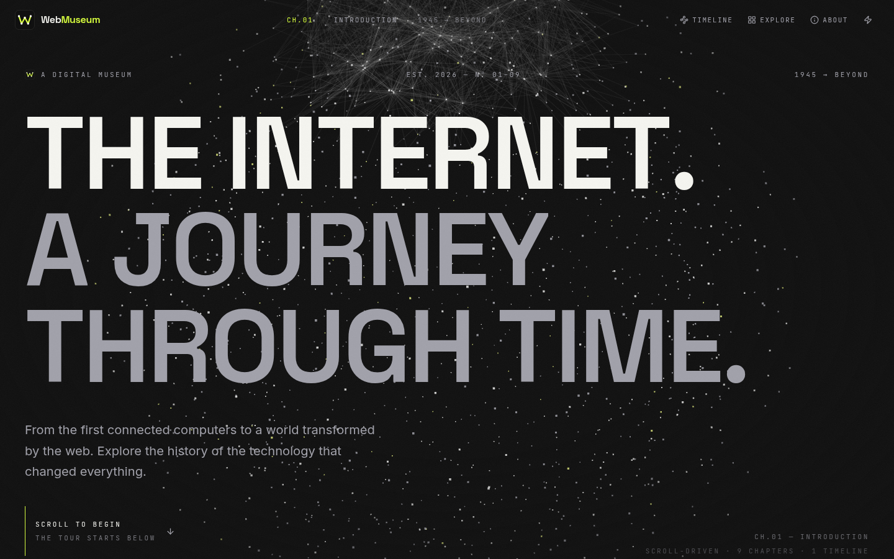
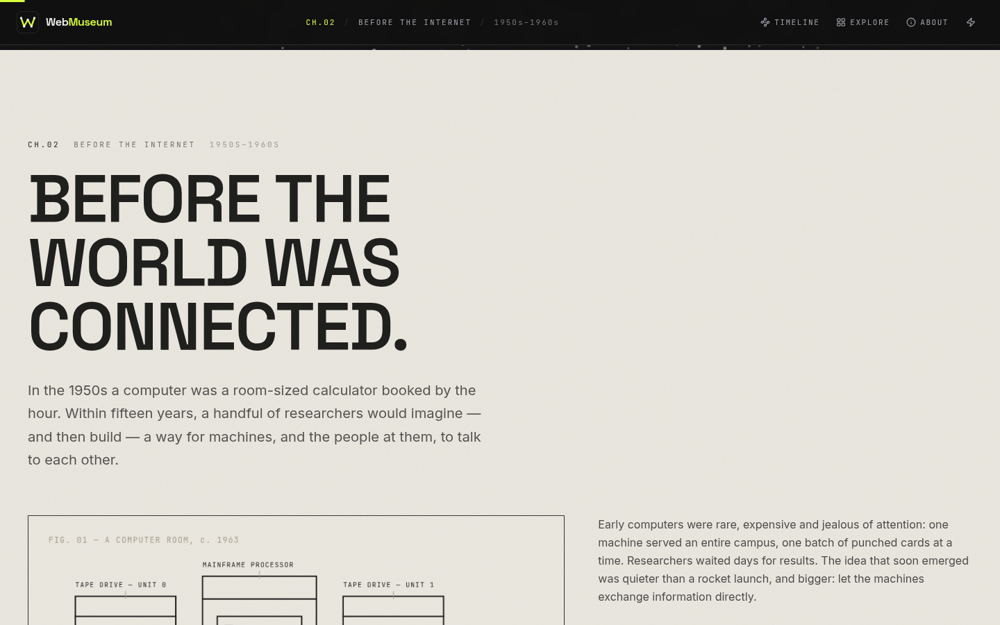
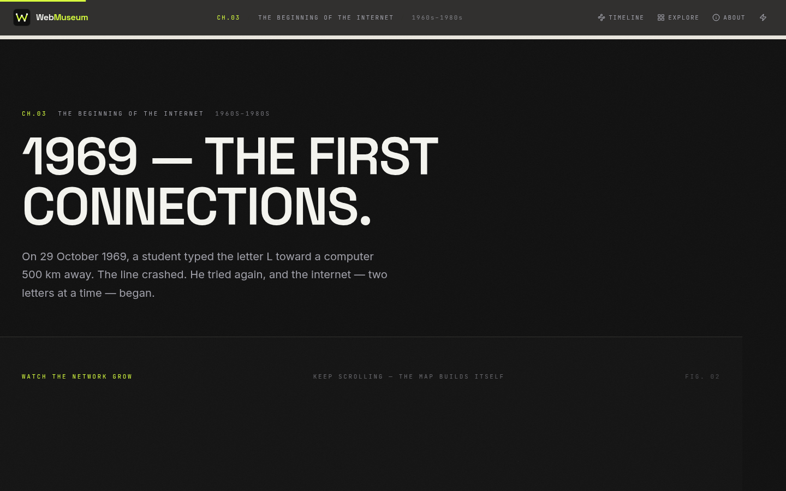
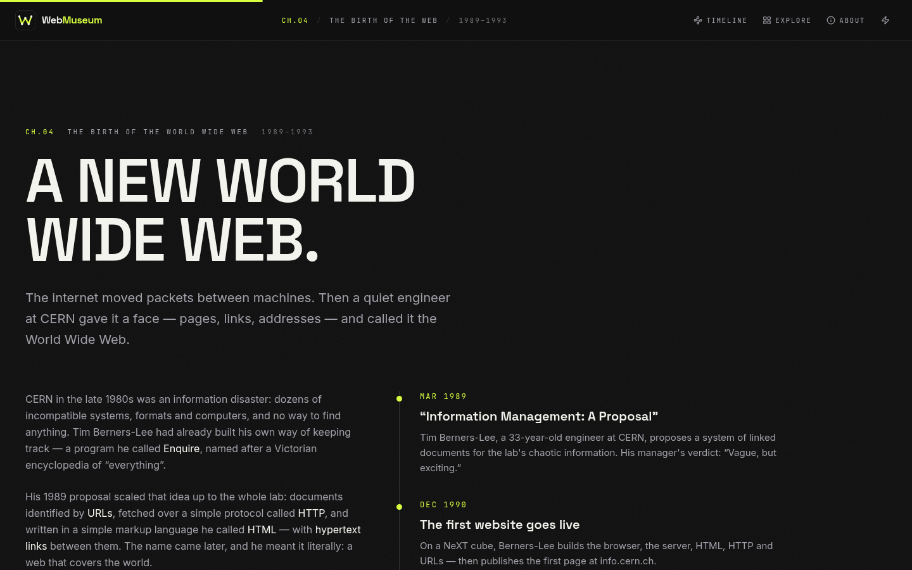
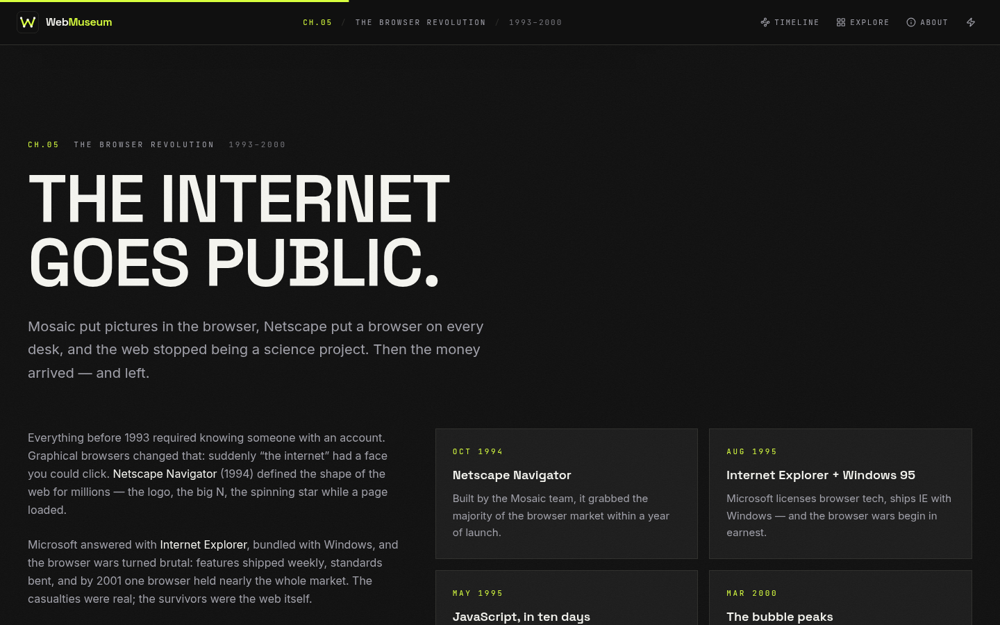
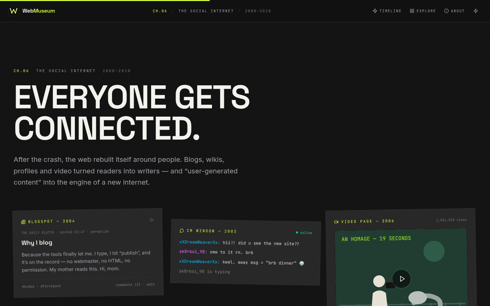
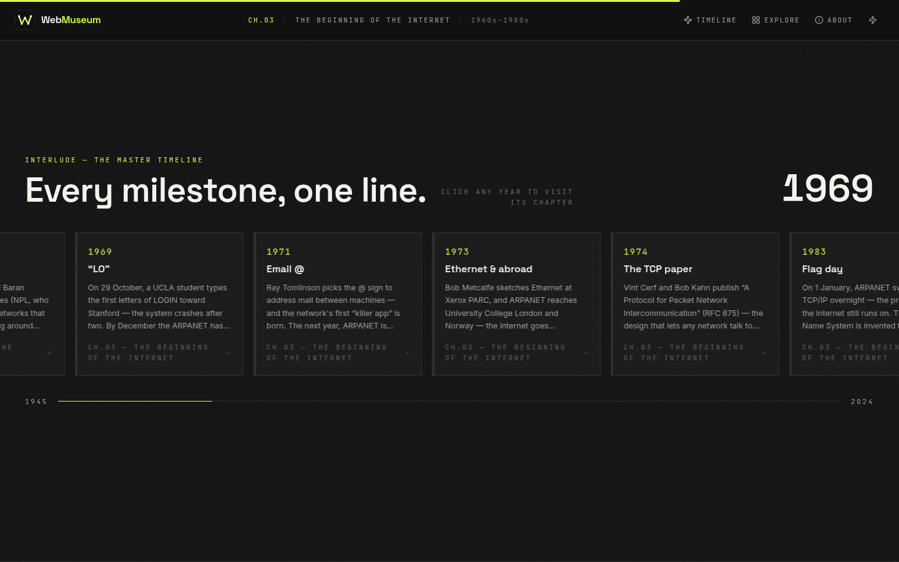
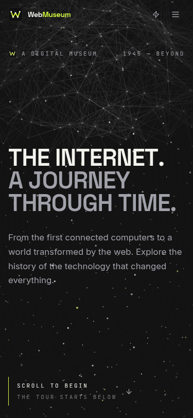

# WebMuseum

**Explore the Evolution of the Internet.**

[](LICENSE)


WebMuseum is an immersive, scroll-driven digital museum about the history of
the internet — from the first ARPANET message in 1969 to a world of 5.5
billion people online. It combines cinematic storytelling, interactive
historical recreations, and carefully sourced educational content into one
continuous journey through nine chapters.

> **Live demo:** `https://your-demo-url.example/`
> *(placeholder — replace this link after you deploy the project)*

---

## The experience

The museum is a single continuous scroll through nine chapters, plus a
horizontal master timeline that recaps the whole journey:

| Chapter | Period | What you'll find |
| --- | --- | --- |
| 01 · Introduction | — | Cinematic hero with a live 3D particle constellation |
| 02 · Before the Internet | 1950s–1960s | Archival-paper chapter: mainframe era, Memex, packet switching, ARPA |
| 03 · The First Connections | 1969–1980s | Scroll-scrubbed ARPANET growth map — 4 nodes → international network → TCP/IP flag day |
| 04 · The Birth of the Web | 1989–1993 | An interactive recreation of the 1990 `WorldWideWeb` browser with working Back / Forward / History and four linked pages |
| 05 · The Browser Revolution | 1993–2000 | A draggable "WM-98" retro desktop with windows, taskbar, start menu, and a fictional late-90s web |
| 06 · The Social Internet | 2000–2010 | A collage of era-authentic panels: blogs, IM, early video, profiles, feeds |
| 07 · The Mobile Revolution | 2010–2020 | A scroll-linked desktop→phone morph exhibit, app era, responsive design |
| 08 · The Modern Internet | 2020–present | Count-up stats (ITU 2024), cloud / real-time / WebAssembly / AI, established vs. emerging |
| 09 · The Future | beyond | A second 3D scene — abstract network lattice — and the museum's closing message |
| — · Master Timeline | 1945–2024 | A pinned horizontal timeline of every milestone; click any year to jump to its chapter |

### Special features

- **Interactive historical timeline** — horizontal, scroll-synchronised, with
  clickable year markers, an active-year readout, and a touch-friendly
  scroll-snap variant on mobile.
- **Era Explorer** — a dialog to browse any era's key events, technologies
  and facts; remembers your last-visited era (localStorage).
- **Did You Know? cards** — concise, sourced historical facts placed through
  the chapters.
- **Reading progress indicator** — a thin accent bar tracking your journey
  through the whole museum.
- **Chapter navigation** — minimal navbar with a live current-chapter
  indicator, plus a full-screen mobile index.
- **Museum information panel** — About WebMuseum with mission, methodology,
  sources & further reading, and full image/font attribution.
- **Motion preferences** — a three-state toggle (automatic / reduced / full),
  persisted per device; `prefers-reduced-motion` is respected by default.
- **Custom cursor** — a quiet trailing ring for fine pointers only, never a
  replacement for the native cursor.

## Tech stack

- **React 19** + **Vite 6** (JavaScript, no TypeScript)
- **Tailwind CSS 4** (CSS-first `@theme` configuration) + custom CSS
- **GSAP 3** with ScrollTrigger, SplitText and `@gsap/react` (pinned scenes, scrubbed timelines, staggered reveals)
- **Lenis** for smooth scrolling, synced to GSAP's ticker
- **Motion for React** for dialogs, menus, hover states and the retro windows
- **Three.js / React Three Fiber / Drei** for the two 3D scenes (lazily
  loaded chunks, paused when off-screen, disposed on unmount)
- **Lucide React** icons · self-hosted **Fontsource** fonts (Space Grotesk,
  Inter, JetBrains Mono — SIL OFL)

No backend, no database, no auth. The entire museum is a static site; the
only persistence is a few `localStorage` keys (motion preference, last era,
guest book entries).

## Getting started

Requirements: **Node.js 20+** (or 22) and npm.

```bash
npm install     # install dependencies
npm run dev     # start the dev server (http://localhost:5173)
```

Production build & local preview:

```bash
npm run build   # outputs a static site to dist/
npm run preview # serve the production build locally
```

The build uses a relative base (`./`), so `dist/` works when served from any
sub-path (e.g. GitHub Pages project sites).

## Project structure

```
webmuseum/
├── public/                  # static assets served as-is
│   ├── favicon.svg
│   ├── favicon/             # PNG icons (32/192/512 + apple-touch)
│   ├── images/og-image.png  # 1200×630 social share card
│   ├── manifest.webmanifest
│   ├── robots.txt
│   └── sitemap.xml
├── docs/screenshots/        # screenshots referenced by this README
├── src/
│   ├── animations/          # GSAP setup, Lenis integration, reveal vocabulary
│   │   ├── gsap.js          #   plugin registration + defaults
│   │   ├── scroll.js        #   smooth scrolling, scrollToTarget, scroll lock
│   │   └── transitions.js   #   [data-split] / [data-fade] / [data-parallax]
│   ├── components/
│   │   ├── Navbar.jsx  Preloader.jsx  ProgressBar.jsx  Cursor.jsx
│   │   ├── Chapter.jsx  ImageReveal.jsx  FactCard.jsx  Footer.jsx
│   │   ├── Timeline.jsx        # the master horizontal timeline
│   │   ├── EraExplorer.jsx     AboutPanel.jsx  Dialog.jsx
│   │   ├── WWWBrowser.jsx      # 1990 WorldWideWeb recreation
│   │   ├── RetroDesktop.jsx    # late-90s desktop experience
│   │   ├── UIContext.jsx  LogoMark.jsx
│   │   └── three/             # HeroScene.jsx, FutureScene.jsx (lazy chunks)
│   ├── data/                 # historical content, separate from components
│   │   ├── chapters.js  timeline.js  events.js  facts.js  sources.js
│   ├── hooks/                # useScrollProgress, useMotionPreference,
│   │   │                     # useIsMobile, useInView
│   ├── sections/             # the nine chapters
│   │   ├── Hero.jsx  Beginning.jsx  InternetOrigins.jsx  BirthOfWeb.jsx
│   │   ├── BrowserEra.jsx  SocialWeb.jsx  MobileEra.jsx  ModernWeb.jsx
│   │   └── FutureWeb.jsx
│   ├── App.jsx  main.jsx  index.css
├── index.html                # SEO, Open Graph, JSON-LD, no-JS fallback
├── vite.config.js
└── package.json
```

## Screenshots

| | |
| --- | --- |
|  |  |
| *Ch. 01 — The Internet. A journey through time.* | *Ch. 02 — Before the world was connected.* |
|  |  |
| *Ch. 03 — Watch the ARPANET grow as you scroll.* | *Ch. 04 — Browse like it's 1990 (recreation).* |
|  |  |
| *Ch. 05 — A desktop from the dial-up days.* | *Ch. 06 — The social internet collage.* |
|  |  |
| *The master timeline (pinned, scroll-scrubbed).* | *Mobile composition.* |

## Accessibility & performance

- Semantic HTML with a logical heading hierarchy; a `<noscript>` summary of
  the whole story for non-JS visitors and crawlers.
- Keyboard support: skip link, focus-visible styles, focus-trapped dialogs
  with Escape-to-close and focus restore, fully operable interactive exhibits.
- `prefers-reduced-motion` honoured by default, plus a persisted manual
  three-state toggle; with reduced motion every pinned scene falls back to a
  static, fully readable layout — no content is hidden behind animation.
- No horizontal overflow at any viewport from 320px up; horizontal
  interactions have scroll-snap touch alternatives on mobile.
- Three.js is split into lazy chunks with static SVG fallbacks; canvases
  pause when off-screen and dispose their GPU resources on unmount; all
  GSAP contexts use `revertOnUpdate` so ScrollTriggers and pin-spacers are
  cleaned up when breakpoints or motion preferences change.
- Self-hosted fonts (no third-party requests), descriptive meta/social tags,
  sitemap and robots.txt. Replace `webmuseum.example` in `robots.txt`,
  `sitemap.xml` and `index.html` with your real domain after deploying.

## Historical accuracy

WebMuseum is an educational project. Historical claims follow primary and
institutional sources, including:

- **CERN** — [The birth of the Web](https://home.cern/science/computing/the-birth-of-the-web) ·
  [Licensing the Web (30 April 1993)](https://home.cern/science/computing/the-birth-of-the-web/licensing-web) ·
  [the restored first website](http://info.cern.ch)
- **Internet Society** — [History of the Internet](https://www.internetsociety.org/internet/history/history-of-the-internet/)
- **Computer History Museum** — [Internet History](https://www.computerhistory.org/internethistory/)
- **W3C** — [A Little History of the World Wide Web](https://www.w3.org/History.html)
- **RFC Editor** — [RFC 675 (TCP, 1974)](https://www.rfc-editor.org/rfc/rfc675)
- **ITU** — [Facts and Figures 2024](https://www.itu.int/itu-d/reports/statistics/2024/11/10/ff24-internet-use)
- **StatCounter**, **Apple**, **Reuters**, **A List Apart** (see the About
  panel in the app for the complete, linked list)

Rules the project holds itself to: verify dates, never fabricate events or
quotations, distinguish established facts from ongoing trends (see
Chapter 08's "established vs. emerging" panels), and link every "Did you
know?" card to its source.

### Image & font attribution

Every illustration, device drawing, interface recreation and photograph-style
artwork in the museum is **original artwork created for this project** and
falls under the project's MIT license. No third-party photographs are used,
nothing is hotlinked, and no real logos or trademarks appear in the
recreations. The first website and browser are © CERN and are referenced by
link, never copied. Fonts are self-hosted via Fontsource under the SIL Open
Font License; icons are Lucide (ISC).

## Contributing

Contributions are welcome — especially corrections with sources:

1. Fork & clone, then `npm install` and `npm run dev`.
2. Keep historical content in `src/data/` (it is deliberately separate from
   components) and cite a reliable source for any date you add or change.
3. Run `npm run build` and make sure it passes with no errors.
4. Open a pull request describing what changed and why.

## License

Released under the [MIT License](LICENSE) — © 2026 WebMuseum contributors.
